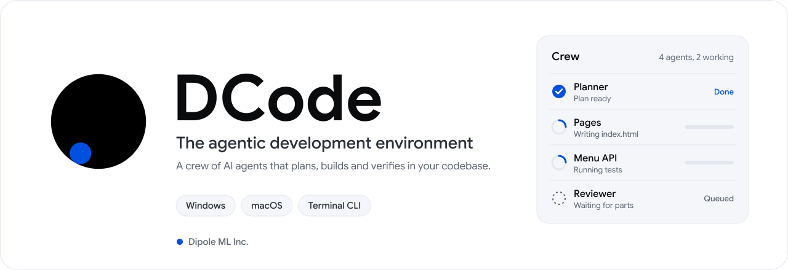

<p align="center">
  <picture>
    <source media="(prefers-color-scheme: dark)" srcset="assets/banner-dark.svg">
    
  </picture>
</p>

<p align="center">
  <a href="https://dipoleml.com/dcode"><b>Website</b></a>&nbsp;&nbsp;&middot;&nbsp;&nbsp;
  <a href="https://docs.dipoleml.com/dcode/install"><b>Docs</b></a>&nbsp;&nbsp;&middot;&nbsp;&nbsp;
  <a href="https://dipoleml.com/download"><b>Download</b></a>&nbsp;&nbsp;&middot;&nbsp;&nbsp;
  <a href="https://docs.dipoleml.com/changelog"><b>Changelog</b></a>&nbsp;&nbsp;&middot;&nbsp;&nbsp;
  <a href="https://dashboard.dipoleml.com/support"><b>Support</b></a>
</p>

<br>

**DCode** is the agentic development environment from **Dipole ML Inc.** Describe a task in plain
language and DCode plans it, splits it across a crew of AI agents that work in parallel, edits your
files, runs your build and tests, and tells you exactly what it verified. It runs as a desktop app
on Windows and macOS, and as a full-screen terminal app anywhere Node.js runs. It is powered by
Raven, the model family built by Dipole ML Inc.

<br>

## Download

<p>
  <a href="https://cdn-dcode.dipoleml.com/dl/win-x64/DCode-2.0.5-win-x64.exe"><picture><source media="(prefers-color-scheme: dark)" srcset="assets/download-windows-x64-dark.svg"></picture></a>
  <a href="https://cdn-dcode.dipoleml.com/dl/win-arm64/DCode-2.0.5-win-arm64.exe"><picture><source media="(prefers-color-scheme: dark)" srcset="assets/download-windows-arm64-dark.svg"></picture></a>
  <a href="https://cdn-dcode.dipoleml.com/dl/mac-arm64/DCode-2.0.5-mac-arm64.dmg"><picture><source media="(prefers-color-scheme: dark)" srcset="assets/download-macos-arm64-dark.svg"></picture></a>
  <a href="https://cdn-dcode.dipoleml.com/dl/mac-x64/DCode-2.0.5-mac-x64.dmg"><picture><source media="(prefers-color-scheme: dark)" srcset="assets/download-macos-x64-dark.svg"></picture></a>
</p>

Free download. Windows 10 or later on x64 and ARM64. macOS 13 or later on Apple silicon and Intel,
signed and notarized by Apple. DCode updates itself in the app.

### Or install the CLI

```bash
npm install -g @dipoleml/dcode-cli
dcode
```

One-line installers that install DCode and start it:

```bash
# macOS and Linux
curl -fsSL https://dipoleml.com/install.sh | sh
```

```powershell
# Windows (PowerShell)
irm https://dipoleml.com/install.ps1 | iex
```

Sign in with your Dipole ML Inc. account. A free account works.

<br>

<!-- SCREEN:hero -->

## What DCode does

<table>
  <tr>
    <td width="50%" valign="top">
      <h3>A crew of up to 24 agents</h3>
      Large tasks are split into independent parts and handed to a crew that works in parallel.
      A shared brief keeps names, interfaces and design choices consistent across the crew, and a
      reviewer runs your real build and tests before the work is reported. The Crew dock shows
      every agent, what it is doing and which one needs you, and you can steer any agent while it
      works.
    </td>
    <td width="50%" valign="top">
      <h3>Agentic by default</h3>
      DCode plans multi-step changes, calls tools in sequence and keeps iterating until the issue
      is resolved. It reads error output from compilers, linters and test runners, fixes what
      fails and runs them again. Every action is visible in the conversation.
    </td>
  </tr>
  <tr>
    <td width="50%" valign="top">
      <h3>Browser and Computer Use</h3>
      DCode drives a built-in browser to check the pages it builds, and when a workflow leaves the
      terminal it can see the screen and operate native desktop apps. Both are ready the moment
      you install.
    </td>
    <td width="50%" valign="top">
      <h3>Native MCP support</h3>
      Connect any Model Context Protocol server in one click. Query databases, read issues,
      inspect live API documentation and call your own internal developer tools from the same
      conversation.
    </td>
  </tr>
  <tr>
    <td width="50%" valign="top">
      <h3>330+ verified plugins</h3>
      The official marketplace installs plugins and skills in one click, hash-verified on every
      download. Built-in plugins create Word documents, PDFs, slide decks and spreadsheets, and
      you can write your own.
    </td>
    <td width="50%" valign="top">
      <h3>Dynamic workflows</h3>
      For long, structured jobs, DCode designs a workflow of phases and agents, shows it as a
      live timeline, and lets you pause, resume or amend a run.
    </td>
  </tr>
  <tr>
    <td width="50%" valign="top">
      <h3>Inspectable reasoning</h3>
      Raven's thinking streams render in plain view, so you can follow why a change was made.
      Choose how hard the model thinks: Off, Low, Standard or High.
    </td>
    <td width="50%" valign="top">
      <h3>Private by design</h3>
      Prompts and diffs are stored encrypted at rest, and your code is never sold or shared.
      Sensitive operations such as pushing to git, deploying or touching credentials ask you
      first unless you choose Full access.
    </td>
  </tr>
</table>

<!-- SCREEN:features -->

## Models

DCode runs on **Raven**, the model family from Dipole ML Inc.

| Model | Best for |
| --- | --- |
| **Raven Max** | Hard engineering work, large refactors and planning. #1 on Terminal Bench 4.0 with a score of 42.8. |
| **Raven Flash** | Fast everyday edits, questions and quick fixes. |

Switch models and thinking levels any time from the model picker in the app, or with `/model` and
`/effort` in the terminal. You can also add your own provider and API key in Settings.

## The terminal app

<!-- SCREEN:cli -->

`dcode` opens a full-screen terminal workspace: header on top, the conversation in the middle, and
the message box and your usage pinned at the bottom.

| Command | What it does |
| --- | --- |
| `dcode` | Open the terminal app in the current folder |
| `dcode -p "fix the failing tests"` | Run one task and print the result |
| `dcode -p "..." --crew always` | Run the task with a crew |
| `dcode doctor` | Check Node, your PATH, sign-in, the browser and git |
| `/model` | Pick Raven Max or Raven Flash |
| `/effort` | Choose the thinking level |
| `/crew` | See what each agent of the latest crew did |
| `/crew mode auto\|always\|off` | Choose when DCode starts a crew on its own |
| `/workflow` | Design and launch a dynamic workflow |
| `/mcp` | Manage MCP servers |
| `/plugins` | Open the plugin manager |
| `/rewind` | Inspect or restore workspace checkpoints |
| `/resume` | Resume a saved session |
| `/setup` | Run first-run setup again |
| `/help` | List every command |

## Plans

DCode is free to download, and a free account is enough to start. The DCode Coding Plan adds the
usage that heavy coding needs. See [dipoleml.com/pricing](https://dipoleml.com/pricing) for current
plans, and the [docs](https://docs.dipoleml.com/dcode/billing) for how usage is measured.

## Requirements

| | Desktop app | Terminal app |
| --- | --- | --- |
| **Windows** | Windows 10 or later, x64 or ARM64 | Node.js 22.13 or later |
| **macOS** | macOS 13 or later, Apple silicon or Intel | Node.js 22.13 or later |
| **Linux** | | Node.js 22.13 or later |

## About Dipole ML Inc.

Dipole ML Inc. is a Toronto-based Canadian sovereign frontier AI lab that builds the Raven model
family, DCode, and the DipoleML API. **Canada's Sovereign AI, Available Globally.**

[dipoleml.com](https://dipoleml.com) &nbsp;&middot;&nbsp;
[X](https://x.com/dipoleml) &nbsp;&middot;&nbsp;
[LinkedIn](https://linkedin.com/company/dipoleml) &nbsp;&middot;&nbsp;
[hello@dipoleml.com](mailto:hello@dipoleml.com)

## License

DCode is proprietary software. Copyright &copy; 2026 Dipole ML Inc. All rights reserved. Use of the
desktop app and the CLI is governed by the [Terms of Service](https://dipoleml.com/tos) and the
[Privacy Policy](https://dipoleml.com/privacy). This repository hosts DCode's public page, release
notes and download links; the source code is not public.
